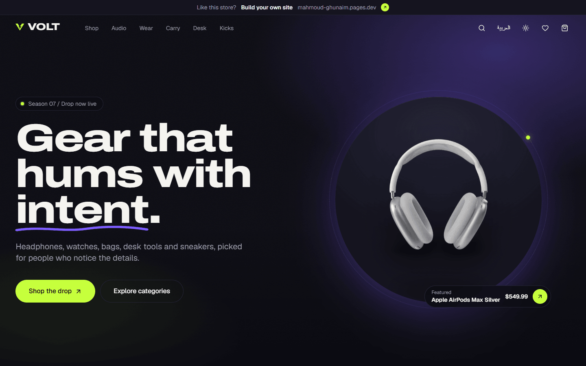
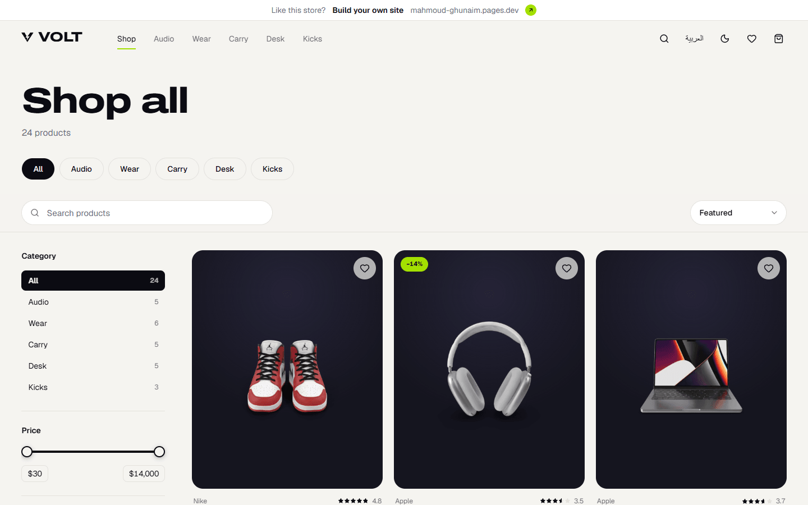
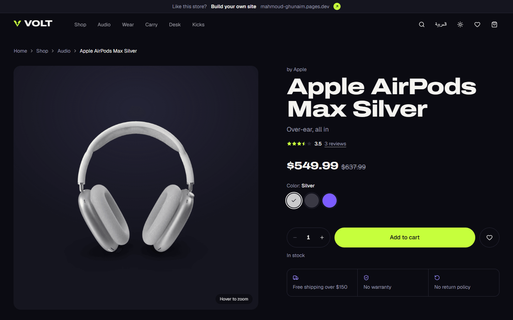
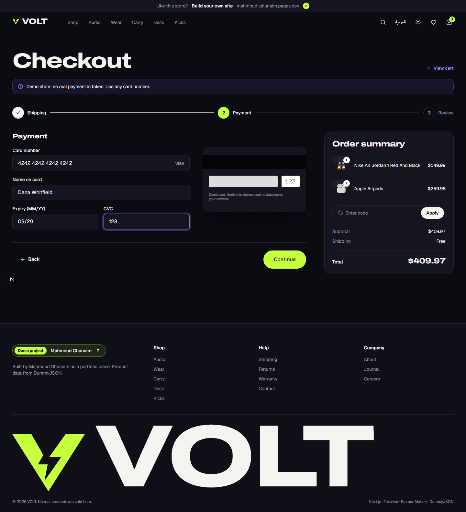
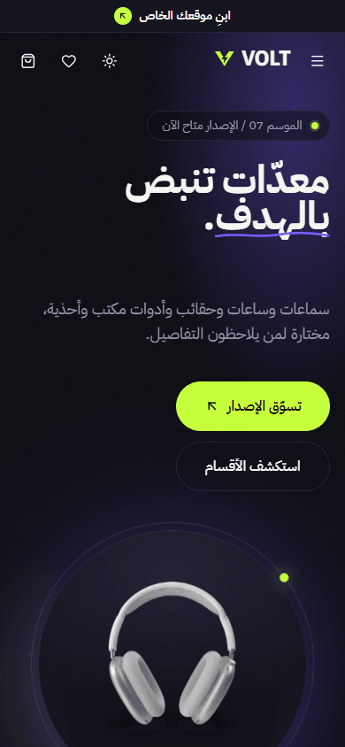

# VOLT — demo e-commerce store

A portfolio-grade storefront for premium tech and lifestyle accessories: audio, watches, bags, desk gear and sneakers. Built with Next.js 16, Tailwind CSS 4 and Framer Motion, in English and Arabic (full RTL).

**Live:** https://volt-shop.mahmoudghunaim132.workers.dev

> **Demo notice:** this is a portfolio project. No real products are sold and no payments are taken. Any card number works at checkout, and nothing leaves your browser.


<!-- Screenshots: add docs/screenshots/{home,shop,product,checkout,arabic}.png -->

| Shop | Product | Checkout | Arabic (RTL) |
|---|---|---|---|
|  |  |  |  |

## Quick start

```bash
npm install
npm run dev        # http://localhost:3000
```

```bash
npm run build      # production build
npm run lint       # ESLint
npm run typecheck  # TypeScript, strict
```

## Deploy (Cloudflare Workers)

The live site runs on Cloudflare Workers through [vinext](https://github.com/cloudflare/vinext), Cloudflare's Vite-based Next.js runtime. The standard Next.js scripts above keep working side by side.

```bash
npm run dev:vinext     # vinext dev server (port 3218)
npm run build:vinext   # build the Worker
npm run deploy:vinext  # build + deploy (needs `cf auth login` once)
```

vinext's config loader needs **Node.js 22.18 or newer**. On an older Node, run any of these through a newer one, for example `npx -y node@24 node_modules/@vinext/cloudflare/dist/cli.js deploy`.

The Worker config lives in `cloudflare.config.ts`. It's set up with no extra Cloudflare resources (no KV, no Cloudflare Images), so it runs on the free plan. Set `NEXT_PUBLIC_SITE_URL` if you move to a custom domain, so the sitemap and Open Graph URLs stay absolute.

## Features

**Storefront**
- Home: parallax hero (the product follows the cursor), brand marquee, bento category grid, drag-to-scroll trending rail, promo countdown, testimonials, newsletter signup
- Catalog: filters for category, price (log-scale slider), color, rating and stock; five sort orders; debounced search with instant results. Every filter syncs to the URL, so any view is shareable. Filters open in a bottom sheet on mobile.
- Product page: gallery with cursor zoom and mobile swipe, color and size variants, quantity stepper, tabs for description, specs and reviews (with star breakdown), related products, sticky add-to-cart bar on mobile
- Cart drawer from any page plus a full cart page: quantity updates, remove with undo, promo code **`VOLT20`** (20% off), free-shipping meter
- Checkout in three steps (Shipping → Payment → Review), validated with react-hook-form and zod; live card preview that flips on CVC focus; order confirmation with confetti
- Wishlist, Quick View modal, toasts, a 404 page with personality
- Help and company pages: Shipping, Returns, Warranty, Contact (validated form), About, Journal (with article pages), Careers

**Craft**
- Light and dark themes, following the system preference, with no flash on load
- English and Arabic with full RTL through logical CSS properties, plus IBM Plex Sans Arabic
- `prefers-reduced-motion` respected everywhere: parallax, marquee, confetti and page transitions turn off
- Keyboard navigable with visible focus rings, ARIA labels and WCAG AA contrast (Lighthouse Accessibility 100)
- SEO: per-page metadata, generated Open Graph images per product, JSON-LD product schema, sitemap and robots
- LottieFiles animations recolored to the brand palette and lazy-loaded
- Cart, wishlist and promo code persist in localStorage (Zustand)
- Overlays (cart, Quick View, mobile menu, toasts) load on demand to keep the first bundle lean

## Tech stack

| | |
|---|---|
| Framework | Next.js 16 (App Router, Turbopack), React 19, TypeScript (strict) |
| Styling | Tailwind CSS 4, OKLCH design tokens as CSS variables |
| Motion | Framer Motion, lottie-web, canvas-confetti |
| State | Zustand (persisted) |
| UI primitives | Radix UI (Dialog, Tabs, Slider, Accordion), sonner, lucide-react |
| Forms | react-hook-form + zod |
| Data | [DummyJSON](https://dummyjson.com/products) with a local snapshot fallback |
| Hosting | Cloudflare Workers via vinext |

## Project structure

```
app/            routes, metadata, sitemap, robots, OG images
components/
  ui/           button, sheet, range slider, lottie
  layout/       header, footer, mobile menu, providers, theme toggle
  home/         hero, marquee, bento, trending rail, promo, testimonials, newsletter
  shop/         product card, quick view, filters, shop view, wishlist
  product/      gallery, purchase panel, variant pickers, tabs
  cart/         drawer, cart line, summary, empty state
  checkout/     checkout flow, card preview, success
  info/         help/company page blocks, FAQ, contact form, journal cards
config/site.ts  brand name, URLs, currency, shipping rules, promo codes
data/           VOLT merchandising layer, categories, testimonials, editorial content
i18n/           en / ar dictionaries, server + client helpers
lib/            data access (api.ts), filters, checkout schema, OG renderer, utils
store/          cart, wishlist, UI (Zustand)
types/          Product, Category, Cart types
```

## Data

`lib/api.ts` is the only file that knows where data comes from. It fetches the DummyJSON catalog (revalidated daily) and merges it with VOLT's merchandising layer in `data/products.ts`, which adds categories, color and size variants, "new" flags, featured order and Arabic copy. If DummyJSON is unreachable, it falls back to `data/dummyjson-snapshot.json`. To refresh the snapshot:

```bash
node scripts/snapshot-dummyjson.mjs
```

Components only use typed functions (`getProducts`, `getProductBySlug`, `getRelatedProducts` and so on), so the source can be swapped for Shopify, Medusa or a custom API by rewriting one file.

## Rebranding

Edit `config/site.ts` (name, tagline, portfolio URL, promo codes, shipping threshold), replace the logos in `public/brand/`, and adjust the color tokens at the top of `app/globals.css`.

Optional campaign imagery (hero backdrop, category tiles) can be dropped into `public/`. See `docs/IMAGE_PROMPTS.md` for file names and generation prompts.

## Credits

Product data and images: [DummyJSON](https://dummyjson.com). Animations: [LottieFiles](https://lottiefiles.com) community creators, recolored. Built by [Mahmoud Ghunaim](https://mahmoud-ghunaim.pages.dev).
